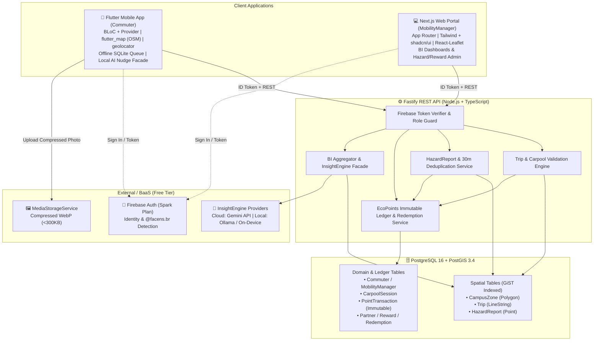
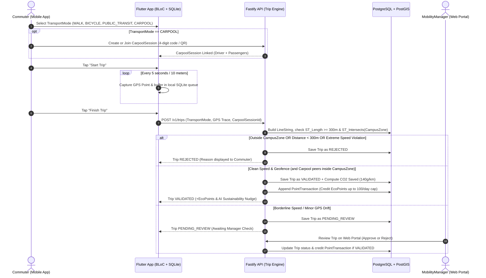
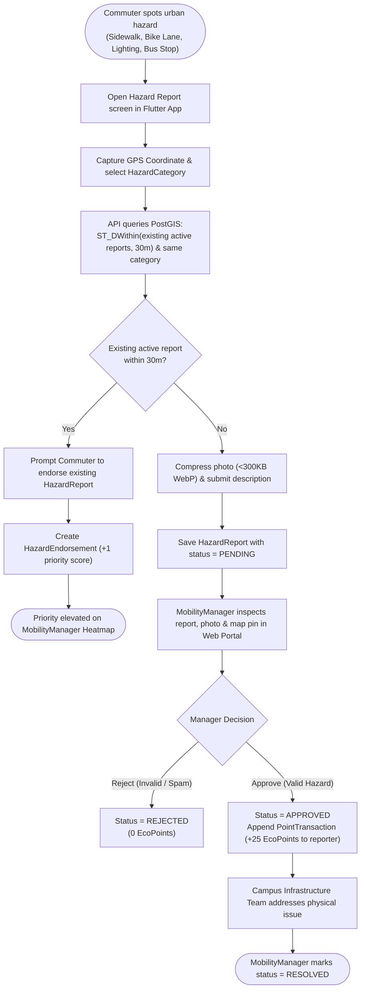
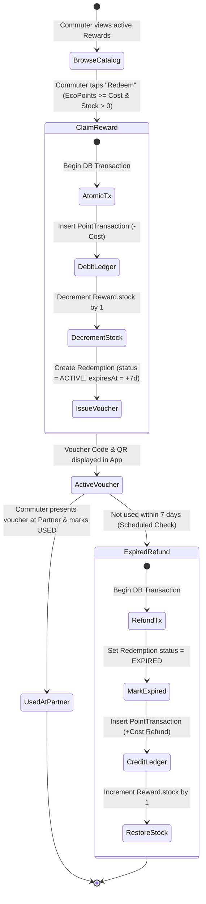

# EcoMove — BPMN Process Flows & System Architecture (UPX IV)

This document maps the core business processes and system architecture of **EcoMove**, fulfilling the **Modelagem de Processos de Negócios (BPMN)**, **Business Intelligence (BI)**, and **Inteligência Artificial (IA)** requirements of UPX IV.

---

## 1. System Architecture Overview

---

## 2. Process 1: Sustainable Trip Recording & Geospatial Validation

This process governs how a `Commuter` records a `Trip` (including optional `CarpoolSession` pairing) and how the backend validates the GPS trajectory against the `CampusZone` polygon and `TransportMode` speed thresholds before crediting `EcoPoints`.

---

## 3. Process 2: Urban Maintenance (`HazardReport`) & 30m Spatial Deduplication

This process maps citizen infrastructure reporting (*zeladoria urbana*), preventing duplicate reports within 30 meters via `HazardEndorsement` and rewarding `Commuter`s once a `MobilityManager` approves the report.

---

## 4. Process 3: `EcoPoints` Economy & `Reward` Redemption Lifecycle

This process ensures atomic stock reservation, single-use voucher generation, and automatic 7-day expiration refunds using an append-only `PointTransaction` ledger.

